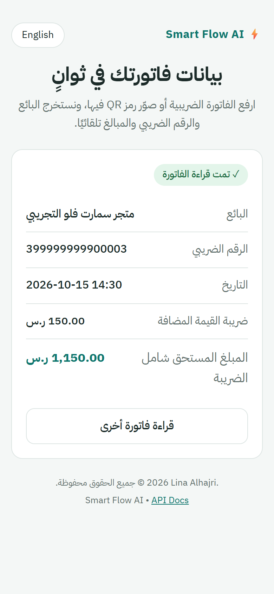
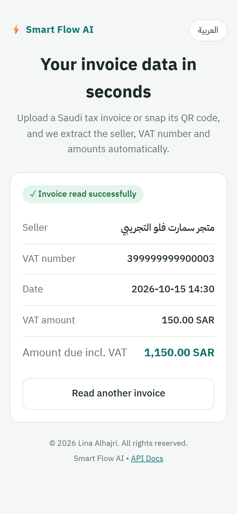
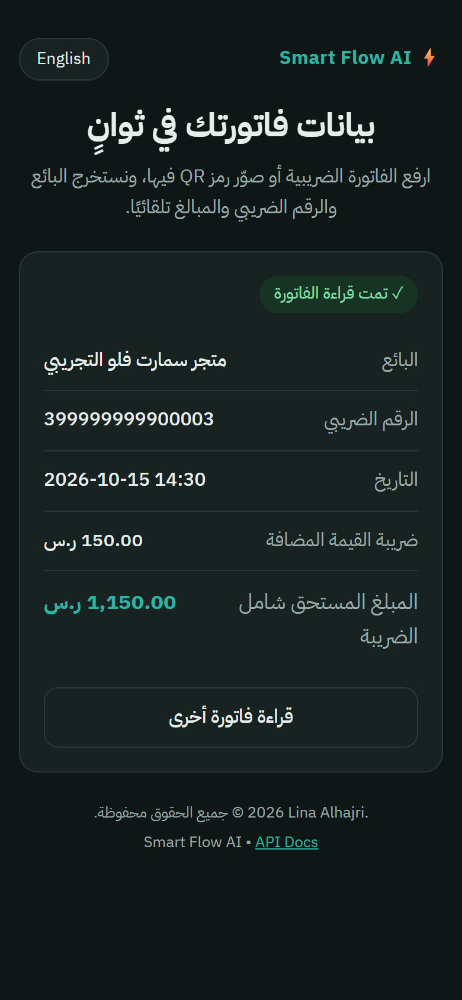
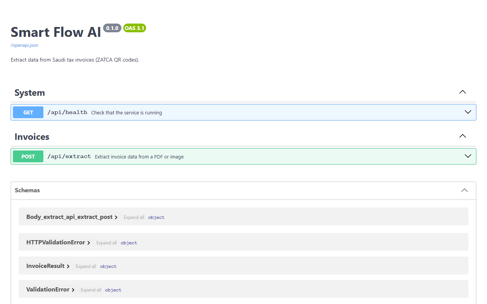

# Smart Flow AI

**Read Saudi tax invoices in seconds.** Upload a PDF or snap a photo of an invoice, and Smart Flow finds the ZATCA QR code and extracts the seller, VAT number, date and amounts.

> **بالعربي:** موقع يقرأ الفواتير الضريبية السعودية ويستخرج بياناتها تلقائيًا من رمز QR الخاص بهيئة الزكاة والضريبة والجمارك. [اقرأ التفاصيل بالعربي ↓](#بالعربي)


<p align="center">
  
  
  
</p>

📘 **Full project overview in Arabic and English:** [docs/PROJECT_OVERVIEW.md](docs/PROJECT_OVERVIEW.md)

## Why

Every tax invoice in Saudi Arabia must carry a QR code defined by ZATCA (the Zakat, Tax and Customs Authority). Even so, accountants still type supplier invoices into their systems by hand.

Reading the printed text is unreliable: Arabic text extracted from PDFs often comes out reversed, with broken letters and swapped dates. The QR code, on the other hand, holds the key fields as exact digital data. Smart Flow reads the QR code instead of guessing from the text.

## Features

- **ZATCA QR decoding:** parses the TLV format, including Phase 2 codes with cryptographic stamp fields.
- **PDFs and photos:** PDF, JPG, PNG and WEBP up to 10 MB. Scans every page of a PDF.
- **Robust on phone photos:** two OpenCV detectors at several image sizes, so blurry or large photos still read.
- **Mobile-first web app:** the camera button opens the phone camera directly; drag and drop on desktop.
- **Arabic and English:** right-to-left and left-to-right layouts, language auto-detected and remembered, plus dark mode.
- **REST API:** documented automatically with OpenAPI at `/docs`.
- **Privacy by design:** uploads are processed in a temporary folder and deleted immediately. Nothing is stored.
- **Batch mode:** a command-line tool processes a whole folder of invoices.
- **Zero cost:** open-source libraries only, no paid cloud services.

## Verified against official ZATCA samples

The decoder was checked against the sample invoices shipped in the official ZATCA e-invoicing SDK (Java R4.0.0 and .NET R3.4.8):

| Sample type | Files | Result |
|---|---|---|
| XML e-invoices (QR compared field by field with the invoice body) | 45 | ✅ 45 / 45 |
| PDF/A-3 invoices (full pipeline: render page, detect QR, decode) | 32 | ✅ 32 / 32 |

The samples cover simplified and standard invoices, credit and debit notes, export, exempt, self-billing and foreign-currency invoices.

One finding from this check: the amount stored in the QR code is the **amount payable** (`PayableAmount`), not the VAT-inclusive total. The two differ when an invoice includes an advance payment or a rounding adjustment, so the app labels it "Amount due".

Run the check yourself after downloading the SDK into `data/zatca-sdk`:

```bash
python scripts/check_zatca_samples.py
```

## How it works

```
Invoice (PDF or photo)
   │
   ▼
InvoiceReader ── validates type and size, fingerprints the file (SHA-256)
   │
   ▼
ExtractionPipeline ── tries extractors in order, stops at the first success
   │
   ├─ 1. QrExtractor      ZATCA QR code  ✅ implemented
   ├─ 2. RegexExtractor   text rules     ⏳ planned
   └─ 3. Local AI         offline model  ⏳ planned
   │
   ▼
InvoiceData ── seller, VAT number, date, amount due, VAT amount
```

The core logic has no knowledge of the web layer. The website, the API and the command-line tool all call the same `InvoiceReader` and `ExtractionPipeline`.

## API



```bash
curl -F "file=@invoice.pdf" http://localhost:8000/api/extract
```

```json
{
  "found": true,
  "page_count": 1,
  "source": "zatca_qr",
  "seller_name": "متجر سمارت فلو التجريبي",
  "vat_number": "399999999900003",
  "issued_at": "2026-10-15T14:30:00",
  "total": "1150.00",
  "vat_amount": "150.00"
}
```

Amounts are returned as strings so no precision is lost. Errors use standard status codes: `415` unsupported type, `413` file too large, `422` unreadable file.

## Tech stack

| Area | Tools |
|---|---|
| Backend | Python 3.13, FastAPI, Uvicorn, Pydantic |
| Documents | pdfplumber, pypdfium2, Pillow |
| QR detection | OpenCV |
| Frontend | HTML, CSS, vanilla JavaScript |
| Testing | pytest, FastAPI TestClient, Playwright for screenshots |

## Getting started

Requires Python 3.11 or newer.

```bash
python -m venv .venv
# Windows: .venv\Scripts\activate    macOS/Linux: source .venv/bin/activate
pip install -e ".[dev]"
cp .env.example .env

python -m smart_flow.web                # website at http://localhost:8000
python -m smart_flow                    # process every file in data/inbox
python scripts/make_sample_invoice.py   # create a sample invoice to try
pytest                                  # run the tests
```

To open the site from a phone on the same Wi-Fi, set `HOST=0.0.0.0` in `.env`.

## Project structure

```
src/smart_flow/
├── reader.py       read and validate files, fix reversed Arabic text
├── qr.py           find QR codes in images and PDF pages
├── zatca.py        encode and decode the ZATCA TLV format
├── extractor.py    extraction pipeline
├── models.py       shared data model
├── config.py       settings from .env
├── main.py         command-line batch tool
└── web/            FastAPI app and static frontend
tests/              pytest suite
scripts/            sample invoice, ZATCA SDK check, screenshots
```

## Engineering notes

A few problems solved along the way:

- **Reversed Arabic text in PDFs.** Text extracted from Arabic PDFs came out in visual order with broken ligatures and swapped dates. Instead of patching every case, the design reads the QR code as the source of truth.
- **QR codes in phone photos.** OpenCV's standard detector failed on blurry, high-resolution photos. Adding the ArUco-based detector and retrying at smaller sizes fixed it, and a regression test proves the old code fails on that case.
- **Bytes versus characters.** TLV lengths count UTF-8 bytes, and each Arabic letter takes two, so Arabic seller names need byte-accurate encoding.
- **Money as `Decimal`.** All amounts use `Decimal`, never `float`.
- **Safe uploads.** User-supplied filenames are never used on disk, uploads are size-capped, and server text is inserted with `textContent` to prevent XSS.

## Roadmap

- [x] Read PDFs and photos
- [x] Decode ZATCA QR codes, verified against the official SDK samples
- [x] Bilingual, mobile-first website and REST API
- [ ] Sample invoices and a "try a sample" button
- [ ] Invoice validation: VAT number format, VAT calculation, duplicates
- [ ] Rule-based extraction for invoices without a QR code
- [ ] Batch upload with Excel export
- [ ] Docker and public deployment

## License

© 2026 Lina Alhajri. All rights reserved. The source code is visible for portfolio and evaluation purposes only. See [LICENSE](LICENSE).

---

## بالعربي

**Smart Flow AI** موقع يقرأ الفواتير الضريبية السعودية خلال ثوانٍ. يرفع المستخدم الفاتورة بصيغة PDF أو يصوّرها بالجوال، فيستخرج الموقع **اسم البائع، والرقم الضريبي، والتاريخ، ومبلغ الضريبة، والمبلغ المستحق**.

**الفكرة:** كل فاتورة ضريبية في السعودية يجب أن تحتوي على رمز QR حسب متطلبات هيئة الزكاة والضريبة والجمارك. قراءة النص العربي من ملفات PDF غير دقيقة، لأنه يخرج معكوسًا أحيانًا، فيقرأ الموقع رمز QR مباشرة ويحصل على بيانات دقيقة.

**أبرز الميزات:**
- يقرأ رموز QR الخاصة بالهيئة، بما فيها رموز المرحلة الثانية.
- يدعم ملفات PDF والصور، ويقرأ صور الجوال حتى لو كانت مهزوزة.
- يعمل على الجوال واللابتوب، وزر التصوير يفتح الكاميرا مباشرة.
- واجهة بالعربية والإنجليزية، مع الوضع الليلي.
- لا يحفظ أي ملف: الفاتورة تُقرأ ثم تُحذف فورًا.
- **مُختبر على نماذج الهيئة الرسمية:** نجح في قراءة 77 ملفًا من 77.

© 2026 لينا الهاجري. جميع الحقوق محفوظة.
